<div align="center">

# Mini FPS Shooting Game

**A first-person shooter for the browser, built in Unity 6.**
Seven arenas, 224 levels, a desert town you can drive through, glass that breaks like glass, and enemies that fight like people.

[](https://minifpsshootinggame.netlify.app)

[](https://unity.com/releases/editor/archive)
[](https://docs.unity3d.com/Packages/com.unity.render-pipelines.universal@17.0/manual/index.html)
[](#platforms)
[](LICENSE)

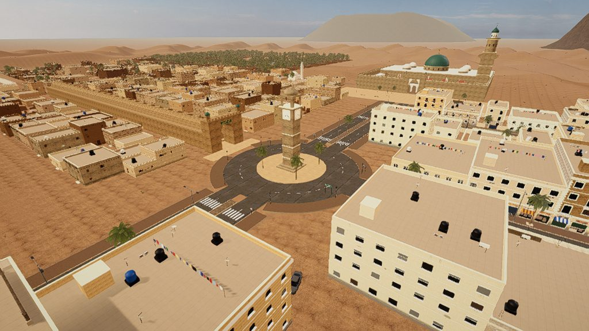

</div>

---

## Play

**[minifpsshootinggame.netlify.app](https://minifpsshootinggame.netlify.app)**: nothing to install, no account. It runs in a desktop browser
(Chrome, Edge or Firefox recommended) and on phones and tablets with on-screen controls. A gamepad works too.

The first load downloads the whole game, so give it a minute on a slow connection.

## What's in it

<table>
<tr>
<td width="50%">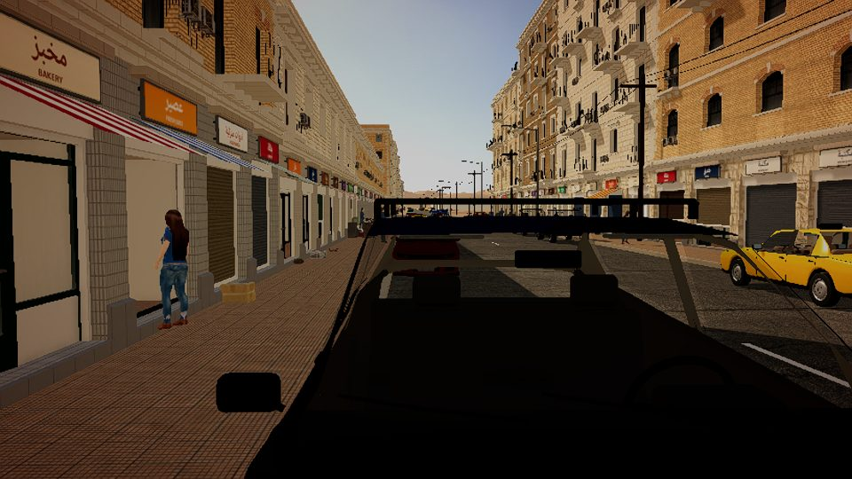</td>
<td width="50%">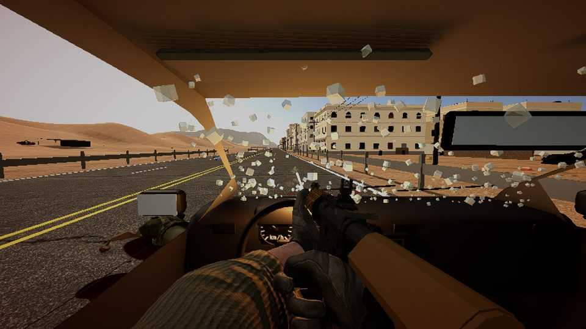</td>
</tr>
<tr>
<td><b>Take any car.</b> Parked or in traffic, first person from the seat or a chase view. Drifts, gears, dents, a gun out of the window.</td>
<td><b>Glass that breaks as geometry.</b> Windscreens star and hold, side windows fall in cubes, shop panes crack from where the round went in.</td>
</tr>
<tr>
<td>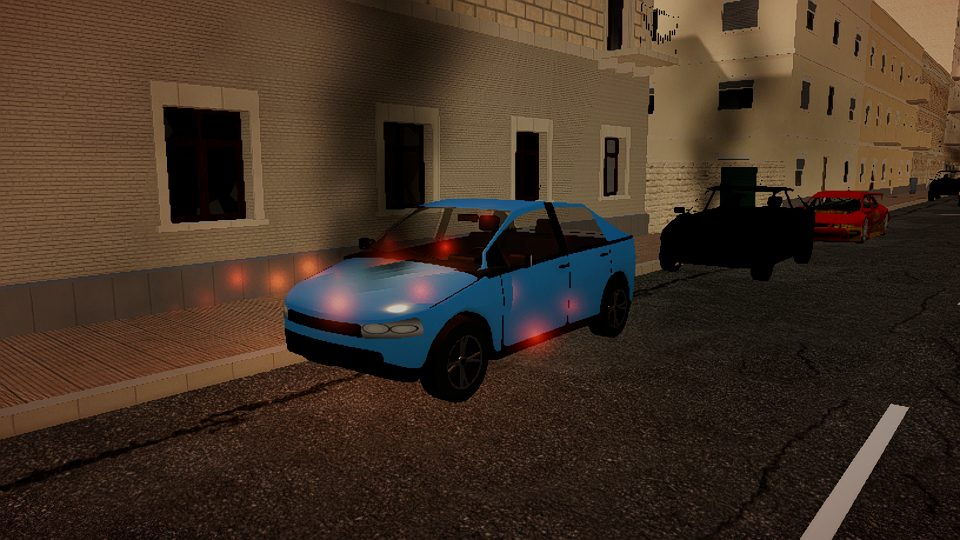</td>
<td>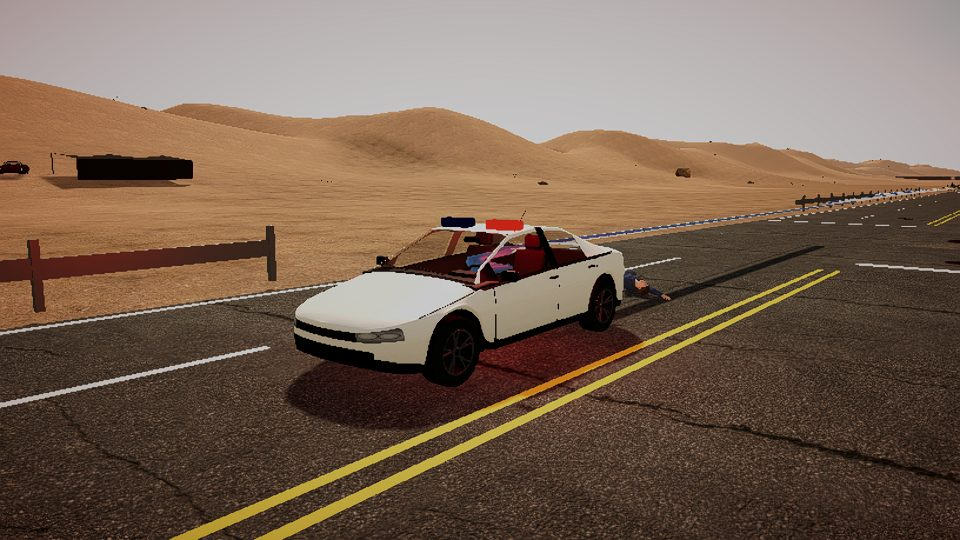</td>
</tr>
<tr>
<td><b>Cars smoke, burn and blow up.</b> Lamp posts, sign poles and bins give way when you drive into them.</td>
<td><b>A wanted level.</b> Hurt civilians or take a car from its driver and the police come for you.</td>
</tr>
<tr>
<td>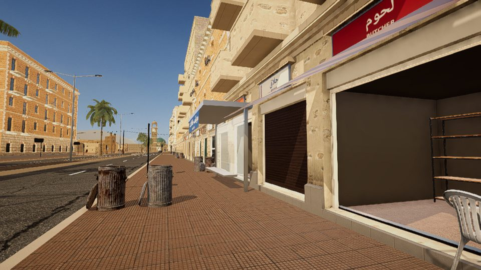</td>
<td>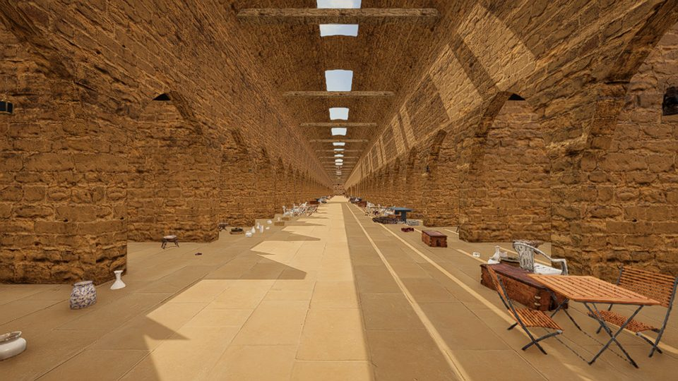</td>
</tr>
<tr>
<td><b>A real town.</b> Avenues, a roundabout, traffic lights the traffic obeys, shops, houses you can walk into, civilians going about their day.</td>
<td><b>Inside as well as out.</b> A covered souk, furnished houses on two floors, a citadel, a mosque plaza, an oasis.</td>
</tr>
</table>

### The fight

- **Enemies that behave like soldiers.** They take cover, flank, and react to where they were hit: a leg wound makes them limp or crawl, a round
  through the neck takes them out of the fight, and a limb hit never kills on its own.
- **Up close.** Punch, kick, or grab a man by the neck and fight him while he tries to fight back and break free.
- **Your own body.** Look down and you see your legs; the view moves with your stride.
- **Guns, bombs and a store.** Kills and stars earn coins for new guns, grenades, energy drinks and upgrades. Run out of ammunition and you
  drop the gun and fight with your fists until you find another.

### Seven arenas

| | | | |
|---|---|---|---|
| 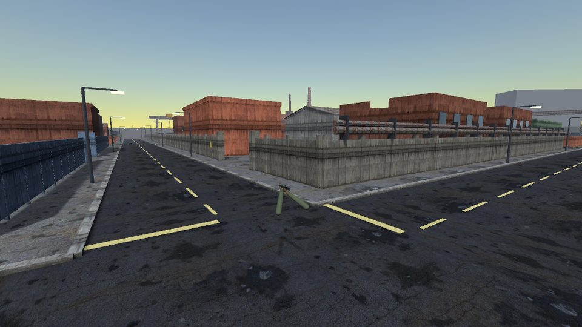 | 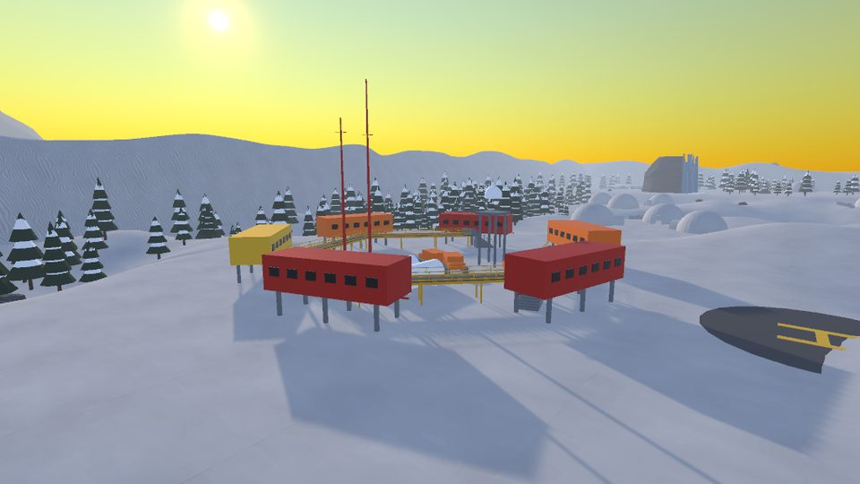 | 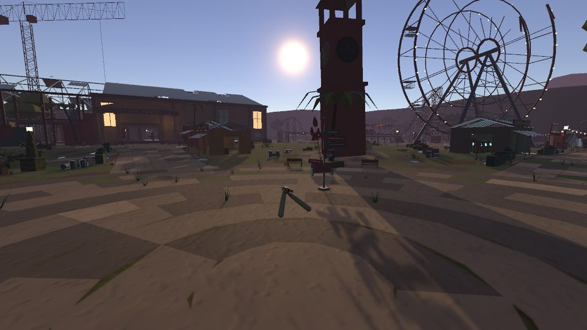 | 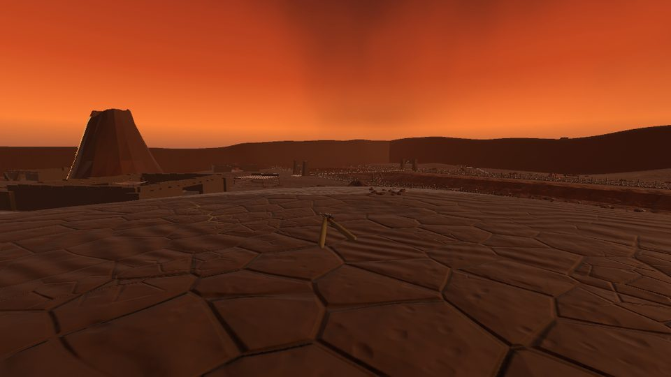 |
| Industrial Warehouse | Snowbound Station | Abandoned Fairground | Mars Colony |

Plus the **Desert Outpost** town, the **Night Rooftop** city district and **The Auger House**. Each arena has **32 levels**, from a
2:30 skirmish to a 15-minute operation. Every level has a fixed enemy roster, a strict clock and an objective, and earns one to three stars.
Stars open the next level and the next arena.

## Controls

| Action | Keyboard and mouse | Gamepad |
|---|---|---|
| Move / look | W A S D (or arrows) / mouse | Left stick / right stick |
| Fire / aim | Left click / right click | RT / LT |
| Jump · crouch · sprint | Space · Ctrl or C · Shift (on its own it runs you forward) | A · B · L3 |
| Reload | R | X |
| Punch · kick | V · B (grab: punch a man face to face) | R3 |
| Grenade | Hold G to aim, release to throw | RB |
| Energy drink | F | LB |
| Get in or out of a car · pick up a gun | E | D-pad up |
| **In a car:** drive · handbrake | W A S D · Space | Sticks and triggers · A |
| **In a car:** gun out (the car holds its speed) · chase view | Q · C | R3 · B |
| Pause / back | Escape | Menu / B |

Every key can be rebound in **Settings**, along with mouse and stick sensitivity, aim assist, graphics quality, blood and camera shake.
On a touchscreen the on-screen controls appear instead.

## Platforms

| Platform | How |
|---|---|
| **Web** | WebGL, published to Netlify. [Play it here](https://minifpsshootinggame.netlify.app). |
| **Desktop** | Windows, macOS and Linux players from the Unity editor. |
| **Android** | Touch layout of its own (not a scaled desktop one); the build is described in the [handbook](Docs/HANDBOOK.md#android-and-google-play). |

Graphics come in three quality tiers, picked once from the device and then the player's choice.

## How it's made

Almost nothing in the game is placed by hand. **Every arena, enemy, level, store item and screen is generated by editor tools** written for
this project (the `FPSKit` menu), and the generated output is saved under `Assets/FPSKit_Generated/`. To change an arena you change the
code that builds it, not the scene.

- **Content is data.** An arena is a `LevelTheme`, an enemy an `EnemyArchetype`, a level an entry in a `LevelSet`, a store item a
  `StoreCatalog` entry: all ScriptableObjects.
- **The desert town** is a fixed street plan built by `FPSKitTown*.cs`: real terrain, draped roads, facades in brick, limestone and plaster,
  interiors cut through the walls, NavMesh proven reachable, light probes and adaptive probe volumes.
- **Our own models.** Cars, world props and civilians come from Blender scripts in `Tools/blender/`; most sounds are synthesised
  by scripts in `Tools/`.
- **Checks, not hope.** Headless play-mode tests drive the game through `Tools/unity-batch.sh`: controls, combat, wounds, levels, store,
  reachability, touch layouts, cars and glass. See [CONTRIBUTING.md](CONTRIBUTING.md).

The full guide to the systems, and how to extend them, is the **[handbook](Docs/HANDBOOK.md)**. The reasoning behind every rule is in
[`Docs/DESIGN_NOTES.md`](Docs/DESIGN_NOTES.md).

## Building it yourself

1. Install **Unity 6000.6.0f1** and **Git LFS**, then clone:
   ```bash
   git clone https://github.com/Ishaan-Kaneria/Mini_FPS_Shooting_Game.git
   cd Mini_FPS_Shooting_Game && git lfs pull
   ```
2. **Import the Asset Store packs** listed below from your own Unity account. They are not in this repository because their licence
   forbids redistributing them. Without them the project still opens and plays, but soldiers, some cars, guns and palms are missing.
3. Open the project, open `Assets/FPSKit_Generated/Scenes/Menu.unity` and press Play.

Publishing the browser build: **Actions → Deploy WebGL to Netlify → Run workflow** builds on GitHub and uploads to Netlify (the packs come from a private repository; see the [handbook](Docs/HANDBOOK.md#continuous-deployment)). `Tools/deploy-web.sh` does the same from your own machine. Headless checks:
`Tools/unity-batch.sh FPSKitBatch.VerifyCombat` and the others listed in [CONTRIBUTING.md](CONTRIBUTING.md).

<details>
<summary><b>Asset Store packs used (not included)</b></summary>

| Pack | Used for |
|---|---|
| Survivalist, Adventure Character | Enemy soldiers' clothing and gear |
| RealisticMobileCars (RMCar26), Touring Car Pack, SportCar | Some of the town's parked and traffic cars |
| Low Poly Weapons VOL.1 | Guns |
| Yughues Free Palm Trees | Palms |
| EEJANAI Team, Procedural Water Shader, AllSkyFree, Low Poly Soldiers (demo), Simple Bone Physics, Mediterranean Ruins Building Kit, Rowlan | Details, water, skies and staging |

The *RPG/FPS Game Assets: Industrial Set* pack is included under its own terms: see [THIRD_PARTY_NOTICES.md](THIRD_PARTY_NOTICES.md).
</details>

## Project layout

```
Assets/
  Scripts/Runtime/        gameplay (flat, global namespace)
  Scripts/Editor/         the FPSKit generators, tests and batch entry points
  FPSKit_Generated/       generator output: scenes, levels, enemies, store, materials
  WebGLTemplates/FPSKit/  the page the browser build ships
  ThirdParty/PolyHaven/   CC0 models and textures
Docs/                     handbook, design notes, audits
Tools/                    unity-batch.sh, deploy-web.sh, Blender and audio scripts
```

## Credits and licence

Code, editor tooling, generated content and documentation: **[MIT](LICENSE)**.
Third-party material keeps its own terms: Poly Haven assets and MakeHuman-generated people are CC0; Asset Store packs are under the
Unity Asset Store EULA. Every downloaded asset is listed in [LICENSES.md](LICENSES.md) and [THIRD_PARTY_NOTICES.md](THIRD_PARTY_NOTICES.md).

Made by [Ishaan Kaneria](https://github.com/Ishaan-Kaneria).
